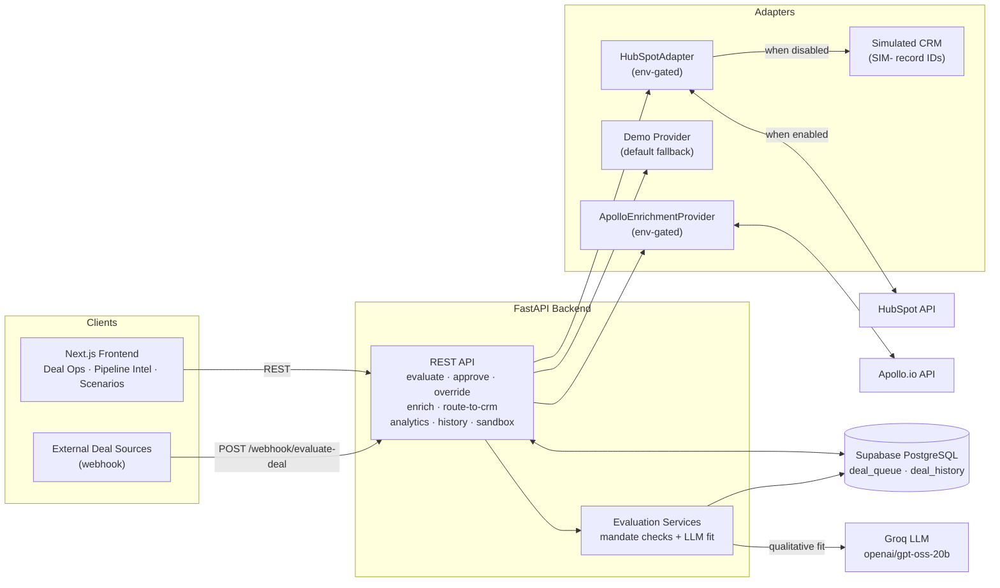

# Indenture

**AI-powered Deal Intelligence and Operations Platform for private-credit teams.**

Live application: **https://indenture-snowy.vercel.app**

Indenture turns incoming deal opportunities into structured, evaluated and actionable pipeline decisions. Every opportunity is checked against lender mandates with deterministic criteria, evaluated with AI-assisted qualitative reasoning, reviewed by a human decision-maker, enriched with company intelligence, and handed off to CRM — with a complete decision history recorded at every step.

It is built for the people who run the deal process: deal operations, pipeline management, and business operations roles. The product mirrors how private-credit origination teams actually work — opportunity qualification, decision support with human oversight, and operational handoffs — rather than presenting itself as a collection of scripts or a generic dashboard.

## The Business Problem

Private-credit origination teams face a set of operational challenges that generic CRMs and spreadsheets don't solve:

- **Incoming deal information is fragmented.** Opportunities arrive from webhooks, referrals, conferences and outreach in different shapes, with inconsistent fields.
- **Every opportunity must be qualified against lender mandates.** EBITDA floors, leverage ceilings, geography and industry exclusions — hard filters that are currently applied by hand.
- **Missing information creates delays.** Deals stall in review because nobody has surfaced *what* is missing or *what the next step should be*.
- **Decision-making needs to be consistent and defensible.** Two reviewers looking at the same deal should reach comparable conclusions, and every decision should be traceable to its reasoning.
- **CRM handoffs and pipeline visibility matter.** A decided deal that never reaches the CRM is lost work; a pipeline nobody can inspect is a pipeline nobody can manage.

## The Solution

Indenture operationalizes this workflow end-to-end:

1. **Structured intake** — an inbound opportunity (webhook or manual entry) is normalized against a lender's mandate and persisted with consistent fields.
2. **Automated evaluation** — deterministic mandate checks (EBITDA, leverage, geography, deal size, industry) run first; an LLM then evaluates qualitative fit and produces a recommendation — **ADVANCE**, **HOLD**, **NURTURE** or **REJECT** — with written evidence, identified information gaps, and a suggested next best action.
3. **Human review** — a decision-maker confirms the recommendation or overrides it with a rationale. Nothing routes to CRM without a human decision.
4. **Company enrichment** — on demand, the deal is enriched with company intelligence (website, revenue, headcount) and mandate checks and the AI evaluation are re-run against the fuller picture.
5. **CRM handoff** — the effective decision is routed to the CRM with a recorded status, record ID, and error trail.
6. **Pipeline intelligence** — operational views surface what's outstanding: what's awaiting review, what's stuck, what failed, and what needs attention first.

## Product Capabilities

### 1. Deal Operations
The working queue for the deal process. Every incoming opportunity appears with its lender, size, source and current recommendation. Filter tabs show the outstanding workload at a glance (awaiting review / approved / rejected), rows surface "Needs info" and review-age signals inline, and the inspector presents evidence, mandate check results, missing information and the recommended next action.

### 2. Pipeline Intelligence
Operational analytics built only from data the system actually records: total opportunities, decisions awaiting review, qualified (ADVANCE) and rejected counts, human decisions made, average deal size, decision distribution, and opportunities by source with advance/reject rates. No estimated or invented metrics.

### 3. Pipeline Health & Needs Attention First
The operational bottleneck view. Four mini-stats quantify where work is stuck — opportunities in review 7+ days, approved decisions awaiting CRM handoff, handoff failures, and HOLDs blocked on missing information. A prioritized **Needs Attention First** queue ranks the top items by operational impact — failed handoffs first, then decisions waiting on their handoff, then stale reviews, then missing-info HOLDs — with an explained reason for every item. Computed from the existing deal log; every surface signal is real.

### 4. Human Review & Decision History
Approve or override any AI recommendation, with a mandatory rationale on override. Every state change — initial evaluation, enrichment events, AI re-evaluations, human approvals, overrides and CRM outcomes — is recorded in an append-only decision history, giving a defensible audit trail per deal.

### 5. Enrichment
On-demand company intelligence. When a deal lacks firmographic data, enrichment fills website, revenue, employee count, ownership type and transaction type — then re-runs mandate checks and the AI evaluation against the updated picture, showing before/after eligibility. Providers are pluggable: Apollo.io when configured, a clearly-labeled demo provider otherwise.

### 6. CRM Handoff
After a human decision, the effective decision routes to the CRM automatically (or manually, on demand), with provider, status, record ID and any error visible on the deal. Simulated record IDs are always labeled "Simulated" — the interface never presents a simulated handoff as a live integration.

### 7. Scenario Analysis
A what-if workspace for mandate criteria. Select a lender, adjust EBITDA floors, leverage ceilings, geography, deal size or industry rules, and see how eligibility of existing pipeline would change — newly eligible, no longer eligible, unchanged — before committing criteria changes in the real world.

## Operational Workflow

```
Inbound opportunity → Company/deal enrichment → Mandate evaluation → Qualification
    → Human review → Decision recording → CRM handoff → Pipeline intelligence
```

- **Inbound:** `POST /webhook/evaluate-deal` (external sources) or `POST /deals/simulate` (manual entry).
- **Evaluation:** deterministic mandate checks + LLM qualitative fit → recommendation, evidence, missing info, next best action, persisted to the deal queue.
- **Human review:** `POST /action/approve` (confirm) or `POST /action/override` (change with rationale) — both recorded in decision history.
- **Enrichment:** `POST /deals/{deal_id}/enrich` — fills gaps, re-runs mandate checks and AI evaluation, records before/after.
- **CRM handoff:** automatic after the human decision, or `POST /deals/{deal_id}/route-to-crm` on demand — the effective decision (override if present, otherwise the AI recommendation) determines the CRM stage.
- **Pipeline intelligence:** `GET /analytics` plus client-computed pipeline health and follow-up prioritization.

## Business Value

The intended operational benefits of running this workflow:

- **Reduced repetitive research** — mandate criteria and first-pass qualification are applied automatically; enrichment fills information gaps on demand instead of through ad-hoc searches.
- **More consistent opportunity qualification** — every deal is evaluated against the same explicit criteria, with the reasoning written down.
- **Better prioritization** — the attention queue makes the most operationally urgent work explicit and explained, rather than buried in a list.
- **Improved pipeline visibility** — counts, distribution, source performance and bottleneck stats are always current, not assembled by hand.
- **More traceable decisions** — approvals and overrides carry rationale into an append-only history, so any outcome can be reconstructed later.
- **Better operational coordination** — decided work has a defined handoff to CRM, with failures visible and retryable.

Indenture is a portfolio product. No customer adoption, revenue or quantified productivity outcomes are claimed.

## Technology Stack

| Layer | Technology | Purpose |
|-------|------------|---------|
| Frontend | Next.js 16, React 18, TypeScript, Tailwind CSS | Deal Operations, Pipeline Intelligence and Scenario Analysis interfaces; pipeline health computed client-side |
| Backend | FastAPI, Python 3.11 | REST endpoints for evaluation, review, enrichment, handoff, history and analytics |
| Database | Supabase (PostgreSQL) | `deal_queue` and `deal_history` tables |
| AI evaluation | Groq (`openai/gpt-oss-20b`) | Qualitative fit evaluation against each lender's exclusion criteria |
| Enrichment | Apollo.io (when configured) / Demo provider | Company intelligence: website, revenue, employees, ownership, transaction type |
| CRM | HubSpot (when configured) | Decision-to-CRM deal creation with stage mapping |

Technology serves the workflow — each piece exists because the business process needs it.

## Integrations

### Implemented: HubSpotAdapter (environment-gated)

`backend/crm_adapter.py` implements a real HubSpot integration, enabled by environment rather than hardcoded:

- When `HUBSPOT_ENABLED=true` **and** `HUBSPOT_ACCESS_TOKEN` are set, routing posts to the live HubSpot API (`api.hubapi.com`), creating a deal with the lender, deal size, EBITDA and leverage mapped to custom properties, and the effective decision mapped to a pipeline stage: ADVANCE → `appointmentscheduled`, HOLD → `qualifiedtobuy`, NURTURE → `presentationscheduled`, REJECT → `closedlost`.
- When not configured, the adapter does not pretend to integrate: it returns a simulated record ID (`SIM-<timestamp>`), stored and surfaced honestly. The UI labels every `SIM-` record **"Simulated"**.

### Implemented: ApolloEnrichmentProvider (environment-gated)

`backend/enrichment_adapter.py` implements real Apollo.io company enrichment, also environment-gated:

- When `APOLLO_ENABLED=true` **and** `APOLLO_API_KEY` are set, enrichment extracts the company domain from the deal's website field, applies **strict domain validation** (rejecting synthetic/test domains such as `localhost`, `test.*`, `demo.*`, `fake.*`), and returns real company data — website, revenue, employee count.
- On failure it returns an actionable error (company not found, invalid domain, authentication, rate limit) — it **will not fake success**.

### Demo behavior (default, clearly labeled)

- **Demo enrichment** (`ENRICHMENT_DEMO_ENABLED=true`, default): deterministic synthetic firmographics derived from the deal and lender names, with a recorded confidence value (~0.85–0.95) and `demo` as the enrichment source. Useful for testing the full workflow without external API keys.
- **Simulated CRM**: `SIM-<timestamp>` record IDs with no external API call, always labeled "Simulated" in the interface.

### Documented roadmap (not implemented)

These paths are documented in the adapter-architecture context and **must not be described as working**:

- **Clay** — waterfall enrichment and pre-pipeline list building; natural entry point is a Clay table pushing qualified companies into the existing `POST /webhook/evaluate-deal` endpoint.
- **Hightouch** — reverse-ETL activation of the Supabase `deal_queue` into downstream GTM tools.
- **Zapier / Make** — lightweight automation around the existing REST API (e.g. alerts on `CRM_ROUTE_FAILED`, digests of opportunities awaiting review).

## Architecture



The frontend talks to the backend REST API (CORS allow-listed) and reads pipeline data directly from Supabase. The backend owns all writes and external calls. External integrations are behind environment-gated adapters with labeled fallbacks — the workflow runs end-to-end whether or not third-party credentials are present.

## Setup

### Prerequisites
- Python 3.11+
- Node.js 18+
- A Supabase project (PostgreSQL)
- A Groq API key
- Optional: Apollo API key, HubSpot access token

### Database (Supabase)

Run `supabase/schema.sql` in the Supabase SQL editor. It creates the `deal_queue` and `deal_history` tables plus indexes.

### Backend (Local Development)

```bash
cd backend
python -m venv venv
source venv/bin/activate        # Windows: venv\Scripts\activate
pip install -r requirements.txt
cp .env.example .env            # then edit .env with your keys
python -m uvicorn main:app --reload --port 8000
```

Backend environment variables (see `backend/.env.example`):

| Variable | Required | Description |
|----------|----------|-------------|
| `GROQ_API_KEY` | Yes | Groq API key for LLM evaluation |
| `SUPABASE_URL` | Yes | `https://your-project.supabase.co` |
| `SUPABASE_KEY` | Yes | Service role or anon key |
| `BACKEND_CORS_ORIGINS` | No | Comma-separated allowed origins (default: `https://indenture-snowy.vercel.app,http://localhost:3000`) |
| `HUBSPOT_ENABLED` | No | `"true"` to enable live HubSpot routing |
| `HUBSPOT_ACCESS_TOKEN` | If HubSpot enabled | HubSpot private-app token |
| `ENRICHMENT_DEMO_ENABLED` | No | `"true"` (default) enables the demo enrichment fallback |
| `APOLLO_ENABLED` | No | `"true"` to enable Apollo enrichment |
| `APOLLO_API_KEY` | If Apollo enabled | Apollo.io API key |
| `PORT` | No | Server port (default `8000`) |

### Frontend (Local Development)

```bash
cd frontend
npm install
# Create .env.local with:
# NEXT_PUBLIC_SUPABASE_URL=your_supabase_url
# NEXT_PUBLIC_SUPABASE_ANON_KEY=your_anon_key
# NEXT_PUBLIC_API_URL=http://localhost:8000
npm run dev
```

### Production Deployment

- **Backend:** Render web service, root directory `backend`, build `pip install -r requirements.txt`, start `python main.py` (binds to `0.0.0.0:PORT`).
- **Frontend:** Vercel, with the three `NEXT_PUBLIC_*` variables set.
- **Database:** the same Supabase project, with `BACKEND_CORS_ORIGINS` including the production frontend URL.

## Limitations

- **Integrations require credentials.** Apollo and HubSpot are implemented but inert until their environment variables are configured with real API keys.
- **Simulated CRM behavior when not configured.** Without HubSpot credentials, handoffs produce `SIM-<timestamp>` record IDs labeled "Simulated" — by design, and never presented as a live integration.
- **Demo enrichment fallback.** Without Apollo credentials, enrichment uses a deterministic demo provider that produces synthetic firmographics, clearly labeled with the `demo` source.
- **No verified external adoption.** Indenture is a portfolio product. There are no customer deployments, paying users, or measured business outcomes behind the claims in this README — the business value section describes intended benefits of the workflow, not measured results.
- **Single-tenant pipeline.** The deal queue is a shared pipeline without per-user authentication or role-based access.

## Documentation

- [Product Case Study](docs/PRODUCT_CASE_STUDY.md) — the business problem, product decisions and trade-offs
- [Architecture](docs/ARCHITECTURE.md) — system design and data flow, based on the actual code
- [Demo Script](docs/DEMO_SCRIPT.md) — a 2–3 minute product walkthrough
- [Screenshot Checklist](docs/SCREENSHOT_CHECKLIST.md) — the captures needed for the portfolio
- [Portfolio Description](docs/PORTFOLIO_DESCRIPTION.md) — resume and LinkedIn-ready text
