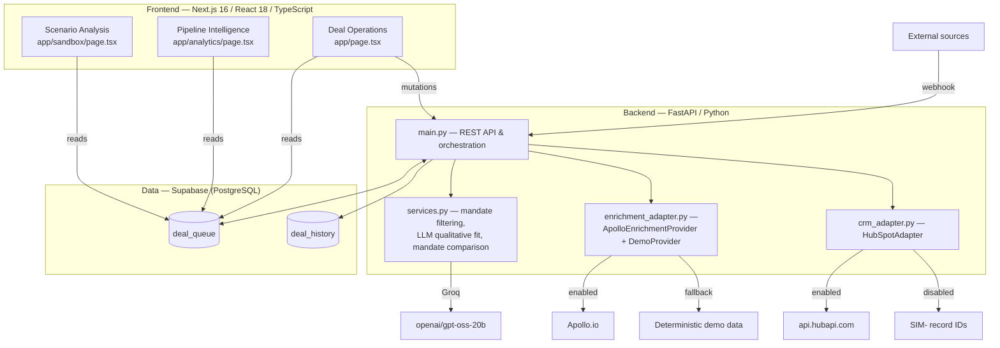
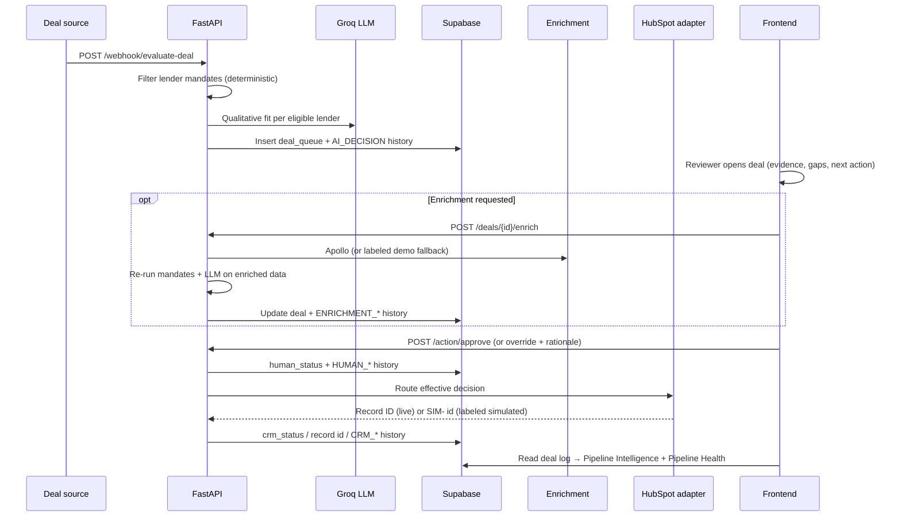

# Indenture — Architecture

This document describes the system as actually implemented. Every component, endpoint and data path below exists in the code.

## System Overview

## Frontend Architecture

Three Next.js App Router pages, sharing a design-system component library:

- **`app/page.tsx` — Deal Operations.** The working queue. Data flows through three hooks in `lib/hooks/`: `useDeals` (reads `deal_queue` directly from Supabase with request-id race protection), `useHistory` (decision history per deal) and `useSimulation` (creating opportunities via the backend). Filter tabs carry workload counts; the selected deal opens in the `DealInspector`, which composes review actions and the CRM/enrichment/re-evaluation panels from `components/triage/`.
- **`app/analytics/page.tsx` — Pipeline Intelligence.** Reads the deal log directly from Supabase (`deal_queue` with an explicit column list) and calls `GET /analytics` for aggregates. `PipelineHealth` (`components/analytics/index.tsx`) computes bottleneck stats and the prioritized attention queue **client-side** from the same rows — no extra endpoints, no fabricated figures.
- **`app/sandbox/page.tsx` — Scenario Analysis.** Loads lenders via `GET /mandate-sandbox/lenders`, submits modified criteria to `POST /mandate-sandbox/simulate`, and renders before/after eligibility.

The frontend performs reads and presentation; **all writes and all external API calls belong to the backend**.

## Backend Architecture

Flat Python package (`backend/`):

| File | Responsibility |
|------|----------------|
| `main.py` | FastAPI app, CORS allow-list, all routes, orchestration, history recording |
| `services.py` | Deal normalization, deterministic mandate filtering, Groq LLM qualitative evaluation, mandate comparison |
| `schemas.py` | Pydantic models for evaluation payloads |
| `crm_adapter.py` | `CRMAdapter` base + `HubSpotAdapter` (env-gated) |
| `enrichment_adapter.py` | `EnrichmentProvider` base + `ApolloEnrichmentProvider` + `DemoEnrichmentProvider` |
| `data.json` | Lender mandate definitions (Apollo Credit, Oak Hill, Blue Owl) |

### REST endpoints

| Method & path | Purpose |
|---------------|---------|
| `POST /webhook/evaluate-deal` | Inbound opportunities from external sources |
| `POST /deals/simulate` | Manual opportunity creation (Deal Ops UI) |
| `POST /action/approve` | Human confirms the AI recommendation |
| `POST /action/override` | Human changes the decision, with mandatory rationale |
| `POST /deals/{id}/enrich` | On-demand company enrichment + re-evaluation |
| `POST /deals/{id}/route-to-crm` | Manual CRM handoff (also automatic after approve/override) |
| `GET /analytics` | Pipeline aggregates from `deal_queue` |
| `GET /deal/history` | Append-only decision history for a deal |
| `GET /mandate-sandbox/lenders` | Lender mandate definitions |
| `POST /mandate-sandbox/simulate` | What-if eligibility analysis under modified criteria |

Access control is a CORS allow-list (`BACKEND_CORS_ORIGINS`, defaulting to the production frontend URL and `http://localhost:3000`); `SUPABASE_URL` is validated to be an `https://*.supabase.co` endpoint before the client is constructed.

## Database

Two tables created by `supabase/schema.sql`:

**`deal_queue`** — the pipeline. Core columns: identity (`deal_name`, `lender_name`, `deal_size`, `industry`, `geography`, `ebitda`, `leverage`, `source`), AI output (`ai_decision`, `evidence`, `email_draft`, `missing_info`, `next_best_action`, `mandate_checks`), human decision (`human_status`, `human_decision`, `override_reason`), enrichment (`enrichment_status/source/confidence`, `enriched_at`, `website`, `revenue`, `employee_count`, `ownership_type`, `transaction_type`), CRM handoff (`crm_provider`, `crm_status`, `crm_record_id`, `crm_routed_at`, `crm_error`), and `created_at`.

Two design notes worth highlighting:

- There is **no `effective_decision` column** — the effective decision is computed at routing time (`human_decision` when overridden, otherwise `ai_decision`), so the decision and the decision-record can never drift apart.
- Enrichment re-evaluation results (`mandate_reevaluation`, `ai_reevaluation`) are **returned in the enrich API response and recorded in `deal_history`**, not stored as columns.

**`deal_history`** — append-only audit trail: `event_type`, `previous_decision`, `new_decision`, `reason`, timestamps. Event types: `AI_DECISION`, `ENRICHMENT_COMPLETED` / `ENRICHMENT_FAILED`, `AI_REEVALUATION`, `HUMAN_APPROVE`, `HUMAN_OVERRIDE`, `CRM_ROUTED` / `CRM_ROUTE_FAILED`.

## AI Evaluation

Evaluation is deliberately two-layered:

1. **Deterministic mandate checks** (`services.py`) — EBITDA ≥ minimum, leverage ≤ maximum, geography within allowed set, plus optional deal-size and industry rules. Hard filters; no model involved. If no lender mandate matches, the webhook short-circuits and nothing is inserted.
2. **LLM qualitative fit** (`evaluate_qualitative_fit`) — for each eligible lender, a structured prompt sends the deal and the lender's qualitative exclusion criteria to Groq (`openai/gpt-oss-20b`) and validates the response into a typed `DealEvaluation`: decision (`ADVANCE` / `HOLD` / `NURTURE` / `REJECT`), written evidence, information gaps (`missing_info`), `next_best_action`, and a suggested outreach email.

The deterministic layer keeps hard criteria consistent; the model handles judgment calls and always explains itself.

## Enrichment

`enrich_deal` orchestrates a provider-agnostic flow:

1. Load the deal from `deal_queue`.
2. Select a provider: `ApolloEnrichmentProvider` if `APOLLO_ENABLED` + `APOLLO_API_KEY`, else `DemoEnrichmentProvider` if `ENRICHMENT_DEMO_ENABLED` (default true).
3. **Apollo path:** extract the domain from `deal.website`, validate strictly (rejects synthetic/test domains), call Apollo, return real revenue / employee count / website. Failures return actionable errors — never a fake success.
4. **Demo path:** deterministic synthetic firmographics hashed from deal + lender names, confidence ~0.85–0.95, source recorded as `demo`.
5. On success: update the enriched fields on the deal, **re-run deterministic mandate checks** against the fuller data, and **re-run the LLM evaluation**. The before/after mandate comparison is returned as `mandate_reevaluation`; a decision change is returned as `ai_reevaluation` and recorded in history.
6. Record `ENRICHMENT_COMPLETED` / `ENRICHMENT_FAILED` in `deal_history`.

## Human Review

- **Approve** (`POST /action/approve`): sets `human_status=APPROVED`, records `HUMAN_APPROVE` in history, then routes the deal to CRM using the effective decision (the AI recommendation).
- **Override** (`POST /action/override`): requires the new decision plus a rationale; sets `human_status=OVERRIDDEN` and `human_decision`, records `HUMAN_OVERRIDE`, then routes to CRM using the override.

Nothing reaches the CRM without a recorded human decision, and every override carries its reason into the audit trail.

## CRM Routing

`crm_adapter.py` defines an adapter interface; `HubSpotAdapter` is the live implementation:

- **Enabled** (`HUBSPOT_ENABLED=true` + `HUBSPOT_ACCESS_TOKEN`): posts to `api.hubapi.com`, creating a deal with lender / size / EBITDA / leverage as custom properties and the effective decision mapped to a stage: ADVANCE → `appointmentscheduled`, HOLD → `qualifiedtobuy`, NURTURE → `presentationscheduled`, REJECT → `closedlost`.
- **Disabled (default):** returns a `SIM-<timestamp>` record ID with no external call. The UI labels these records "Simulated" — the system never presents a simulated handoff as a live integration.

Outcomes are persisted back to the deal (`crm_status`, `crm_record_id`, `crm_error`) and recorded in history as `CRM_ROUTED` / `CRM_ROUTE_FAILED`, which is what the Pipeline Health view reads to surface failures and pending handoffs.

## Pipeline Analytics

- `GET /analytics` aggregates server-side from `deal_queue`: total deals, decision distribution, average deal size, and opportunities by source with advance/reject rates.
- The **Pipeline Intelligence** page adds client-computed operational views from the same rows:
  - **Pipeline health mini-stats:** opportunities stuck in review 7+ days; approved/overridden decisions awaiting CRM handoff; handoff failures; HOLDs pending with missing information.
  - **Needs Attention First:** a deduplicated, severity-ranked queue (failed handoff → pending handoff → stale review → missing-info HOLD, oldest first within a tier), each item showing the reason it is surfaced.

All figures derive from recorded data and timestamps — nothing is estimated or simulated.

## End-to-End Data Flow

